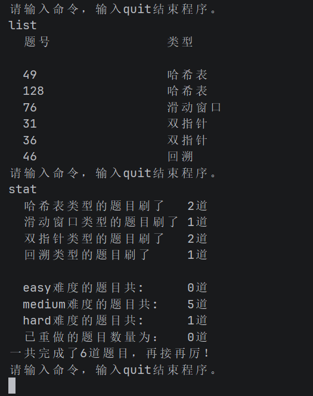

# DrillLog · 刷题记录工具

一个在终端里记录 LeetCode 刷题情况的小工具。用命令添加、查询、统计，
数据自动保存到本地，关掉再打开还在。

## 它解决什么问题

刷题时题目、思路、重做记录散落在各处，回头复习找不到重点。
DrillLog 把这些集中在一个 JSON 文件里，用几个短命令就能查：
某类题刷了多少、哪道做过两遍、某道题的思路是怎么写的。

## 环境要求

- Python 3.8 或更高（只用标准库，无需 pip 安装任何东西）
- 目前只支持 Windows

## 运行

    git clone https://github.com/prrray175/DrillLog.git
    cd DrillLog
    python lc.py

## 命令

| 命令 | 作用 |
| --- | --- |
| `add` | 添加一道题（交互式问答） |
| `list` | 列出全部题目 |
| `list <类型>` | 只看某一类型的题目 |
| `find <关键词>` | 按关键词搜索类型和思路 |
| `find <题号>` | 按题号精确查找 |
| `done <题号>` | 标记为已重做 |
| `del <题号>` | 删除记录，可一次删多个 |
| `stat` | 统计各类型、各难度、已重做数量 |
| `save` | 手动保存（平时会自动保存） |
| `help` / `quit` | 查看帮助 / 退出 |

## 用法示例

## 数据存在哪

    %APPDATA%\DrillLog\problems.json

- 每次添加、修改、删除后**自动保存**，退出时再存一次
- 想备份，直接复制这个文件
- 如果文件损坏，程序会把它备份成 `problems.broken.json` 再继续启动，
  不会直接覆盖你的原数据

## 已知限制

- 列表只显示题号和类型，完整信息用 `find`
- 只支持 Windows

## 开发过程

按分步任务书完成，共 10 次提交，覆盖命令解析、数据持久化、
异常处理、重构和界面打磨。